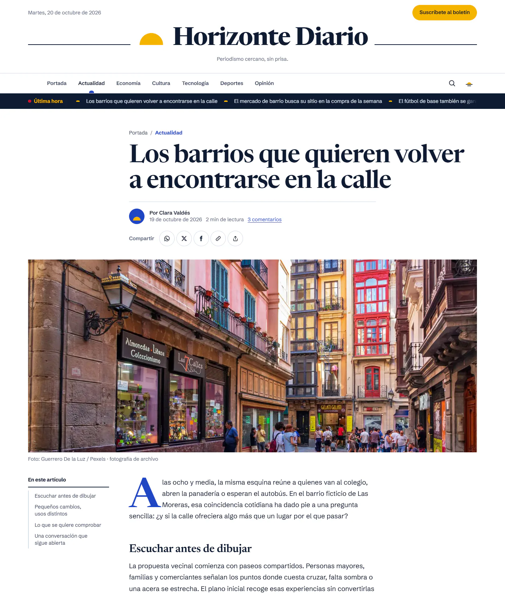
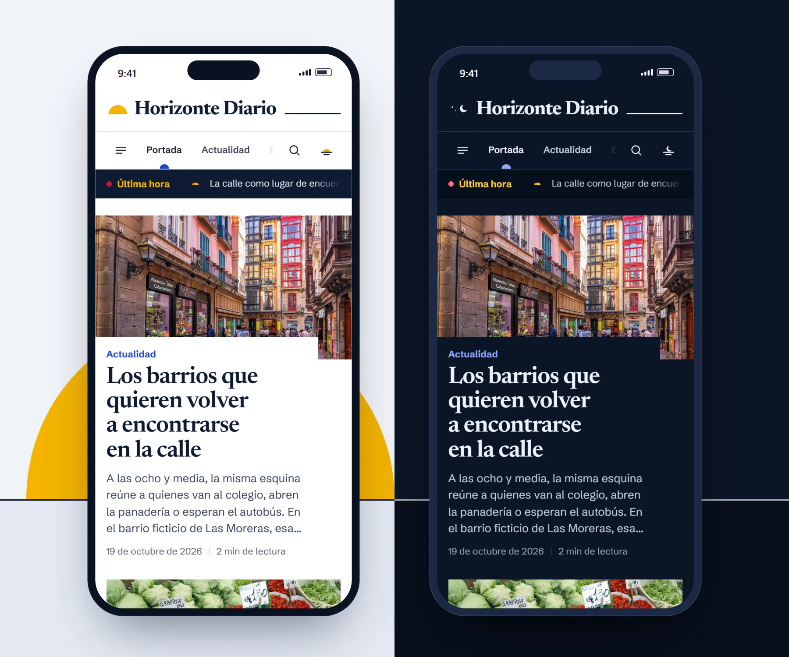

# Horizonte Diario · Tema de periódico para Blogger

[](https://github.com/USUARIO/horizonte-diario-blogger/actions/workflows/pages.yml)
[](LICENSE)


Tema completo para convertir un blog de **Blogger** en un **periódico digital** moderno: portada con noticia destacada, franja de «Última hora», bloques por sección, artículos cómodos de leer y modo oscuro. Es rápido en el móvil, accesible y está optimizado para buscadores. Se instala importando un único archivo, [`theme/theme.xml`](theme/theme.xml), y se configura desde el panel de Blogger sin tocar código.

**[Ver la demo en vivo](https://USUARIO.github.io/horizonte-diario-blogger/)** · **[Descargar theme.xml](theme/theme.xml)** · **[Guía de instalación](theme/README.md)**

> Las noticias, autores y declaraciones de la demo son ficticios. «Horizonte Diario» es una marca de demostración.

---

## Destacados

- **Portada de periódico**: noticia principal + dos secundarias, «Últimas noticias» con botón **«Más noticias»** que carga sin recargar la página, bloque «A fondo» elegido por la redacción y un bloque por sección que **no repite** noticias ya visibles.
- **Artículo**: antetítulo de sección, sumario automático, barra de progreso de lectura, tiempo de lectura, foto de portada a todo lo ancho (sin duplicarla en el texto), compartir (WhatsApp, X, Facebook, copiar enlace y menú nativo del móvil), «Más de la sección» y comentarios nativos de Blogger.
- **Modo oscuro** automático (según el sistema) y con botón, sin parpadeo al cargar y con transición circular donde el navegador la admite.
- **Búsqueda** en panel con resultados mientras escribes, navegable con flechas y Esc.
- **Accesible (WCAG 2.1 AA)**: navegación completa con teclado, foco visible, menús modales con el foco atrapado y Esc, anuncios para lectores de pantalla, contraste verificado por tests y respeto a «reducir movimiento».
- **Rápido**: sin jQuery ni frameworks. JavaScript propio de unos 23 KB, cargado en diferido. Imágenes con `srcset` usando el redimensionado de Blogger, carga diferida y prioridad alta para la foto principal. CSS en línea y fuentes que no bloquean el dibujado.
- **SEO para noticias**: datos estructurados `NewsArticle`, `BreadcrumbList` y `NewsMediaOrganization` + `SearchAction`, Open Graph y X Cards, URL canónica, secciones indexables, y búsquedas y etiquetas de tema con `noindex`.
- **Editable sin código**: 46 variables en el Diseñador de Blogger (colores claro y oscuro, color por sección, tipografías), y secciones, menú, «Última hora», boletín y pie en Diseño.
- **Detalle Blogger resuelto**: Blogger ordena las etiquetas alfabéticamente, así que el tema reconoce cuál de ellas es la *sección* con una expresión lambda del propio Blogger, en vez de tomar «la primera».

## Capturas

| Portada (claro) | Portada (oscuro) |
|---|---|
|  |  |

| Artículo | Móvil (claro y oscuro) |
|---|---|
|  |  |

## Instalar en Blogger (resumen)

1. **Copia de seguridad** del tema actual: Tema → ▾ junto a *Personalizar* → *Crear copia de seguridad*.
2. **Importar**: Tema → ▾ → *Restaurar* → sube [`theme/theme.xml`](theme/theme.xml).
3. **Ajustes recomendados** (Configuración): *Feed del sitio* = **Completo** (imprescindible para «Última hora», «Más noticias» y la búsqueda), **9 entradas** en la página principal, comentarios **Insertados** y zona horaria de tu país.
4. **Secciones = etiquetas**: cada noticia lleva una etiqueta de sección (Actualidad, Economía, Cultura, Tecnología, Deportes u Opinión) y las de tema que quieras.
5. **Primera foto después del primer párrafo**: es la portada de la noticia y la imagen al compartir.

La guía completa (gadgets, cómo publicar, colores, logotipo, solución de problemas) está en **[theme/README.md](theme/README.md)**.

## Cómo funciona

```
src/  ──npm run build──▶  theme/theme.xml  ──npm run preview──▶  preview/ (55 páginas)
                              │                    ▲
                              └── validador ───────┘ motor de plantillas Blogger + datos de prueba
```

- **Una sola fuente de marcado.** `theme.xml` se **genera** a partir de parciales (`src/theme/`), del CSS (`src/styles/`, tokens en `src/tokens.json`) y del JS (`src/js/`). No se edita a mano.
- **El preview es el propio tema**: un mini motor de plantillas de Blogger (`tools/lib/engine.mjs`) ejecuta `b:section`, `b:widget`, `b:includable`, `b:if`, `b:loop`, expresiones `expr:` y lambdas sobre datos con la misma forma que los de Blogger. Lo que se ve en la demo es exactamente lo que se importa.
- **Validador propio** (`npm run validate`): XML bien formado y reglas del motor de Blogger (widgets, secciones, includables, variables del Diseñador, expresiones y referencias `data:`), con mensajes que apuntan al archivo fuente.

## Desarrollo

Requisitos: **Node.js 20+** (22 recomendado) y, para la prueba E2E, Edge o Chrome.

```bash
npm ci
npm run build    # genera theme/theme.xml y lo valida
npm run dev      # sirve el preview en http://localhost:4173 con las rutas de Blogger
npm run check    # build + preview + ESLint + Stylelint + html-validate + tests
npm run smoke    # prueba E2E en Edge/Chrome sin interfaz (36 comprobaciones)
```

Preview bajo una subcarpeta (como GitHub Pages):

```bash
npm run preview -- --base https://usuario.github.io/horizonte-diario-blogger/ --out _site
```

El workflow [`.github/workflows/pages.yml`](.github/workflows/pages.yml) hace `npm ci` y `npm run check`, y publica la demo en GitHub Pages. La base se calcula del usuario y del repositorio, y se puede cambiar con la variable de repositorio `PREVIEW_BASE`.

## Estructura

```
theme/
  theme.xml              tema generado (el archivo que se importa en Blogger)
  README.md              guía de instalación y configuración
src/
  theme/                 esqueleto XML, head (SEO, fuentes), lógica de Blog1 y parciales de presentación
  styles/                CSS por capas (reset, base, layout, components, pages, motion, utilities)
  tokens.json            tokens de diseño: colores, secciones, tipografía, espacio y movimiento
  js/                    JavaScript del tema (módulos ES → esbuild → IIFE en línea)
tools/
  build.mjs              compila el tema
  validate.mjs           valida cualquier tema de Blogger
  render-preview.mjs     genera el preview desde theme.xml
  serve.mjs              servidor local con las rutas de Blogger y compresión
  smoke.mjs              prueba E2E por Chrome DevTools Protocol
  lib/                   parser XML, expresiones, motor, mock, catálogo de Blogger, CSS e imágenes
tests/                   pruebas unitarias (node:test)
content/                 12 noticias de demostración (HTML listo para el editor de Blogger) y fotos
docs/screenshots/        capturas
```

## Tecnologías

Blogger Layouts v3 (XML con `b:`, `data:` y `expr:`) · HTML semántico · CSS moderno (cascade layers, custom properties, `clamp()`, view transitions y animaciones por scroll como mejora progresiva) · JavaScript vanilla (módulos ES) · Node.js (esbuild, saxes, sharp, Capsize) · node:test, ESLint, Stylelint, html-validate · Chrome DevTools Protocol · GitHub Actions y GitHub Pages.

## Calidad

- **54 pruebas unitarias**: expresiones de Blogger, validador, motor de plantillas, datos de prueba, módulos JS y **contraste WCAG AA** de todos los pares de colores del tema.
- **36 comprobaciones E2E** en un navegador real: ticker, «Más noticias», bloques sin repetir, modo oscuro persistente, búsqueda con teclado, menú móvil modal, portada sin duplicar la foto, sumario, compartir, relacionadas, 404, sin scroll horizontal a 390 px y consola sin errores.
- **Validación**: el tema sale sin errores ni avisos del validador, y el preview sin errores de html-validate.
- **Lighthouse** (preview local): 100 en las cuatro categorías en la portada de escritorio. En los artículos, el marcado nativo de los comentarios de Blogger, que el tema no controla, resta algún punto de accesibilidad y SEO.

## Créditos y licencias

- **Código y tema**: licencia [MIT](LICENSE) © 2026 Michael Härter König.
- **Fotografías de la demo**: [Pexels](https://www.pexels.com), bajo la [licencia de Pexels](https://www.pexels.com/license/). **No están cubiertas por la licencia MIT.** Ilustran noticias ficticias: no documentan los hechos ni representan a sus protagonistas.
- **Tipografías**: [Newsreader](https://fonts.google.com/specimen/Newsreader) y [Schibsted Grotesk](https://fonts.google.com/specimen/Schibsted+Grotesk), vía Google Fonts (SIL Open Font License 1.1).

| Noticia de demostración | Foto |
|---|---|
| Los barrios que quieren volver a encontrarse en la calle | [Guerrero De la Luz](https://www.pexels.com/photo/people-walking-on-the-street-14264400/) |
| El tren cercano se juega su futuro en los viajes de cada día | [selmate](https://www.pexels.com/photo/railway-station-platform-16780213/) |
| Un huerto vecinal donde también se cultiva el relevo entre generaciones | [Alfo Medeiros](https://www.pexels.com/photo/man-and-woman-watering-the-plants-12916211/) |
| El mercado de barrio busca su sitio en la compra de la semana | [CARLOSCRUZ ARTEGRAFIA](https://www.pexels.com/photo/a-fresh-vegetables-on-the-market-11097810/) |
| Compartir local para sostener el pequeño comercio | [Raphael Loquellano](https://www.pexels.com/photo/people-by-the-cafe-counter-16139853/) |
| La biblioteca que invita a leer sin mirar el reloj | [Ayşe İpek](https://www.pexels.com/photo/books-in-the-library-13278839/) |
| El cine de barrio defiende la emoción de una pantalla compartida | [Anand M](https://www.pexels.com/photo/modern-empty-cinema-hall-with-black-seats-29505262/) |
| Antes de cambiar de portátil, una conversación con el taller | [Oelnbod](https://www.pexels.com/photo/close-up-of-laptop-repair-with-tools-37821110/) |
| El móvil que deja espacio para terminar una conversación | [Atahan Demir](https://www.pexels.com/photo/hand-holding-phone-12079714/) |
| El fútbol de base también se gana aprendiendo a ser equipo | [Omar Ramadan](https://www.pexels.com/photo/a-ball-on-a-football-field-9468611/) |
| Una ruta ciclista donde el ritmo lo marca el grupo | [Tuvalum](https://www.pexels.com/photo/cyclists-cycling-on-road-17239276/) |
| También tenemos derecho a entender las noticias sin correr | [Mateusz Dach](https://www.pexels.com/photo/man-reading-newspaper-347682/) |

## Autor

**Michael Härter König** · Full Stack Developer.

---

## English

**Horizonte Diario** is a complete **newspaper theme for Blogger**: a front page with lead story, breaking-news ticker, section blocks, "load more" without reloads, a comfortable article page (table of contents, reading progress, reading time, sharing, related stories), dark mode, and live search. It's accessible (WCAG 2.1 AA), fast (no frameworks, about 23 KB of deferred vanilla JS, responsive images through Blogger's resizer) and SEO-ready (`NewsArticle`, `BreadcrumbList`, Open Graph, canonical URLs).

Install it by restoring [`theme/theme.xml`](theme/theme.xml) in Blogger (Theme → ▾ → Restore). Colours, fonts and sections are editable from Blogger's Theme Designer and Layout, with no code. Full guide (in Spanish): [theme/README.md](theme/README.md).

Under the hood, `theme.xml` is **generated** from partials, CSS and ES modules. The live demo is rendered from that same file by a small Blogger template engine written for this project, so the preview is exactly what gets imported. Quality: 54 unit tests, 36 end-to-end browser checks, a custom Blogger theme validator, and a GitHub Actions workflow that runs every check and publishes the demo to GitHub Pages.

```bash
npm ci && npm run check   # build, validate, preview, lint, tests
npm run dev               # http://localhost:4173
```

Code: [MIT](LICENSE) © 2026 Michael Härter König, Full Stack Developer. Demo photos: [Pexels](https://www.pexels.com) under the [Pexels License](https://www.pexels.com/license/) (not MIT).
